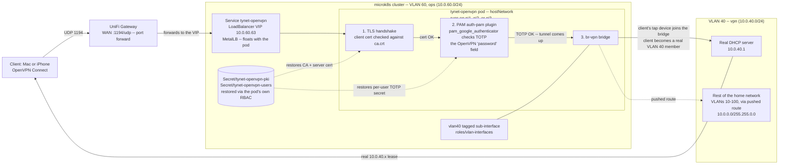

# tynet-openvpn

Self-hosted OpenVPN remote-access server for `tynet.us`. Bridges its tap
device into the node's `vlan40` link (see `tya/tynet-infra`'s
`roles/vlan-interfaces`) so connecting clients become real members of the
home network's `vpn` VLAN — not a routed look-alike subnet. Two-factor via
PAM + `libpam-google-authenticator`: a client certificate for TLS identity,
a TOTP code for the OpenVPN "password" field.

Deployed into the `tynet-infra` microk8s cluster by ArgoCD — see
`gitops/openvpn/` in that repo. This repo only holds the image
(`Dockerfile`, `entrypoint.sh`, `up.sh`, `issue-client.sh`,
`sync-user.sh`) and its Helm chart (`deploy/charts/tynet-openvpn`); there
are no secrets committed here — the CA, server cert, and each user's TOTP
seed are all generated fresh in-cluster on first run and live in
Kubernetes Secrets, never on disk in this repo.

**Floatable, not pinned to a node.** The pod carries no `nodeSelector` —
all three cluster nodes trunk VLAN 40, so it can run on any of them. Two
things make that actually work rather than just technically schedule:

- **State lives in Secrets, not a PVC.** This cluster's storage class
  (`hostpath-storage`) is node-local, which is why `meal-planner` and
  `tynet-cloud-init` are pinned to one node for their PVCs. A VPN server
  needs its CA to survive a reschedule, so instead `entrypoint.sh` reads
  and writes the PKI (and each enrolled user's TOTP secret) via the pod's
  own ServiceAccount (`rbac.yaml` grants it `get`/`create`/`patch` on
  Secrets in its own namespace, nothing else) — Secrets live in etcd, not
  on whichever node happened to run the pod first.
- **A floating VIP, not a node IP.** `service.yaml` fronts it with a
  MetalLB `LoadBalancer` Service (`externalTrafficPolicy: Local`, so only
  the node actually running the pod answers for it) — the WAN port
  forward (see `gitops/openvpn/application.yaml` in `tynet-infra`) points
  at that VIP, not at any one node's address.

## Architecture

How a connection actually gets from the internet onto the home network,
across the two VLANs involved and through the cluster:



**VLAN 60 is where the cluster lives; VLAN 40 is where the client ends
up.** Those are deliberately different networks. pi1/pi2/pi3 are all on
`ops` (VLAN 60) — that's where the Service VIP and the pod itself run,
regardless of which node gets scheduled. But the pod's job is to bridge
the client into a *second*, separate VLAN (`vpn`, VLAN 40) that nothing
else in the cluster is on. The client is never a member of VLAN 60; it
only ever talks to the one VIP there (`10.0.60.63:1194/udp`), then lands
on VLAN 40 as a real member via the bridge, indistinguishable from a
wired device there.

**Two factors, checked in order, both inside the pod:**

1. **Something you have** — the OpenVPN/TLS handshake itself verifies the
   client's certificate against the CA (`verify-client-cert require`).
   This happens before any credentials are exchanged; a client without a
   valid cert never gets this far.
2. **Something you know** — once the TLS session is up, OpenVPN's
   `auth-pam` plugin hands the username/password fields to PAM.
   `pam_google_authenticator` treats the password field as a TOTP code
   and checks it against that user's enrolled secret. There's no
   `pam_unix` in the stack — a correct cert with the wrong TOTP code (or
   vice versa) is rejected either way.

Only after both checks pass does OpenVPN bring the tunnel up and hand the
client's `tap` device to `up.sh`, which joins it to `br-vpn` — the same
bridge the node's `vlan40` link is already enslaved to. That's the moment
the client actually becomes a VLAN 40 device: it gets a normal DHCP lease
from the real `10.0.40.1` server, same as anything else on that VLAN.

**Why this needs to run in Kubernetes (and why not an ordinary pod):**

- `hostNetwork: true` is what lets the pod see the real `vlan40` link in
  the first place — a normal pod only sees Calico's virtual network, with
  no VLAN 40 to bridge into.
- The CA and every enrolled user's TOTP secret live in two Kubernetes
  Secrets (`tynet-openvpn-pki`, `tynet-openvpn-users`), not a PVC — this
  cluster's storage class is node-local, and Secrets aren't, which is
  what lets the pod actually reschedule to any of the three nodes without
  losing its identity or locking out enrolled users.
- A MetalLB `LoadBalancer` Service gives it one stable VIP
  (`10.0.60.63`) regardless of which node ends up running it — the WAN
  port forward points at that VIP, never at a node's own address.

## Image

`ubuntu:24.04` + `openvpn`, `easy-rsa`, `libpam-google-authenticator`,
`kubectl` (pinned to the cluster's version, checksum-verified).

- `entrypoint.sh` — on every start: restores the CA/server PKI from
  `Secret/tynet-openvpn-pki` (bootstraps + saves it there on first run
  instead), restores every previously-enrolled user's TOTP secret from
  `Secret/tynet-openvpn-users`, bridges the node's `vlan40` link into
  `br-vpn`, renders `server.conf`, execs `openvpn`.
- `up.sh` — OpenVPN's `--up` hook: joins the tap device to the same
  bridge once OpenVPN creates it.
- `issue-client.sh <device>` — signs a new client cert against the
  restored CA and prints a ready-to-import `.ovpn` profile. The server
  never needs to retain issued client certs itself (TLS verification only
  checks the chain against `ca.crt`), so this reconstructs a throwaway
  easy-rsa `pki/` dir each time rather than keeping one around.
- `sync-user.sh <name>` — pushes one user's enrolled TOTP secret into
  `Secret/tynet-openvpn-users`. Run this right after enrolling someone —
  without it, their TOTP secret only exists in that pod's ephemeral
  filesystem and is gone the moment it reschedules.

Built and pushed to `ghcr.io/tya/tynet-openvpn` on every `v*` tag (see
`.github/workflows/image.yml`), `linux/arm64` only (the cluster is all Pi
nodes).

## Client enrollment

Not part of this repo — it's an interactive, per-user/per-device runbook,
run against whichever pod is currently live:

```sh
# One-time per user: enroll TOTP, then push it to the cluster.
kubectl exec -it deploy/tynet-openvpn -n openvpn -- bash -c \
  'mkdir -p /etc/openvpn/users/ty && google-authenticator -s /etc/openvpn/users/ty/.google_authenticator'
kubectl exec -it deploy/tynet-openvpn -n openvpn -- sync-user.sh ty

# Per device: issue a cert and capture the resulting .ovpn profile.
kubectl exec -i deploy/tynet-openvpn -n openvpn -- issue-client.sh my-mac > my-mac.ovpn
```

Import the `.ovpn` into **OpenVPN Connect** (Mac App Store / iOS App
Store) — connecting prompts for a username (the enrolled name above) and
the current TOTP code.
